# KuhinjaCAD — from kitchen layout to CNC program

**A Windows desktop application for designing kitchens and cabinets and taking them all the way to the workshop floor.**
Place cabinets along a wall and the program generates every panel, every drilled hole and groove, the cut list, an optimized sheet layout, part labels, shop drawings and CNC programs — and shows the result in 3D, including a path-traced render.

> **About this repository.** This is the *portfolio page* for the project: documentation and screenshots only.
> **The source code is private** and is not published here. A live demo or a code walkthrough is available on request.

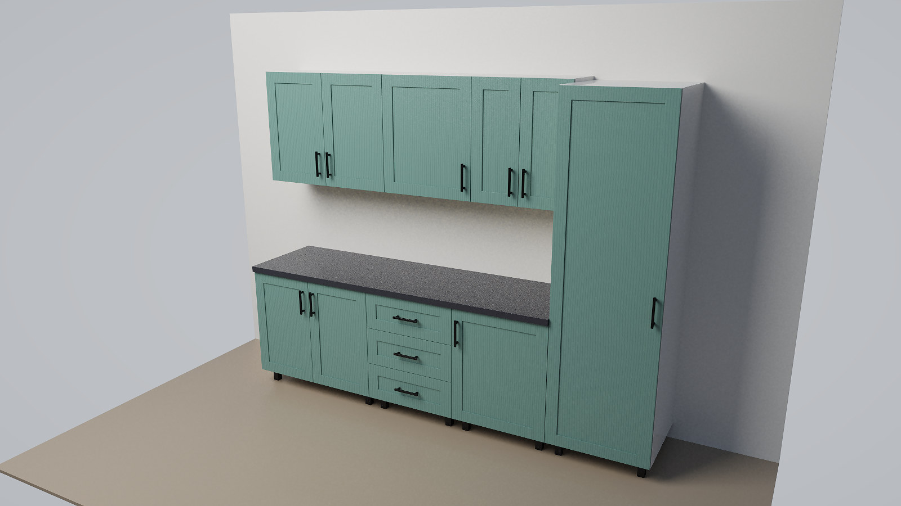

## Highlights

- **~25,000 lines of C#** written as a hands-on way to learn desktop-application design, 3D graphics, geometry/optimization algorithms and CNC fundamentals.
- **No third-party libraries.** Only the .NET Framework that ships with Windows. The 3D engine, the path tracer, the nesting optimizer, the DXF writer and the formula parser are all written from scratch.
- **One model, many outputs.** A single parametric cabinet model feeds the 2D elevation, the 3D view, the cut list, the nesting, the CNC post-processor, the labels and the hardware list — so they never disagree.
- **Bilingual user interface** (English / Serbian) implemented without touching the business logic.

## What it does

| Area | Capabilities |
|---|---|
| **Design** | Base, wall, tall and drawer cabinets; a library of ready-made cabinets; rooms with arbitrary walls, doors and windows; corner (L-shaped) cabinets; wardrobes with hinged or sliding doors; free subdivision of a cabinet interior (shelves, dividers, doors, drawers, built-in appliances); glass "river" inlays; floating TV units |
| **Construction rules** | Cabinets are built from simple inputs: toe kick or adjustable legs, back panel in a groove / overlay / full, joinery (dowels, confirmat screws, cam locks), hinge cups and plates, drawer slides (side-mount and undermount), handles, LED channels, wall-hanging systems, finished-end panels |
| **CNC** | Every part gets its drilling, grooves, pockets and contours. Editable operations table with mouse dragging, simple CAD shapes, formulas in input fields (`x/2`, `y-50`); post-processor producing a text CNC program; DXF export |
| **Production** | Cut list (CSV and print), panel-saw and CNC nesting with grain matching, edge-banding marks, 50×30 mm labels for thermal printers, hardware specification |
| **Presentation** | 2D elevations with dimensions, 3D view with colors and textures, exploded cabinet view with part numbers, assembly instructions, shop drawings (PDF / DXF), software path-traced render |
| **Everyday comfort** | Undo / redo, copy / paste, multi-select, millimetres or inches (including `34 1/2"` input), measuring tool, English and Serbian UI |

## Screenshots

*All screenshots show the program's English interface with a demo project. The outputs (renders, drawings, lists, labels) are exactly what the program generates.*

### Design: layout, 3D, exploded view

| Kitchen layout (elevation) | 3D view |
|---|---|
| 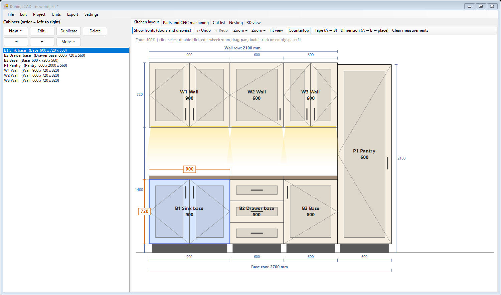 | 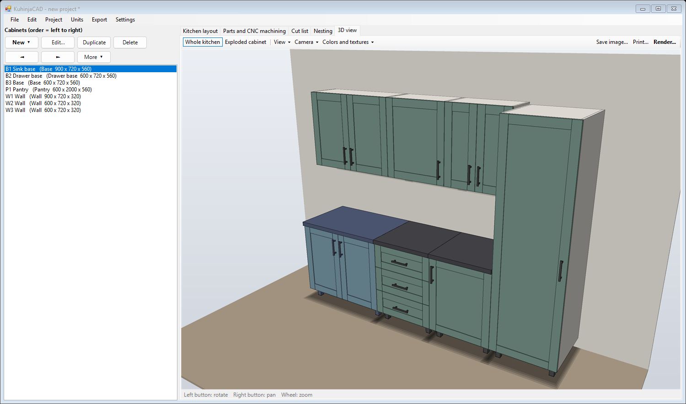 |

### Photorealistic render (built-in path tracer)

### Every part with its CNC machining
Each panel is drawn in a CAD-style view; holes, grooves and edge banding are layers, and every operation is editable in the table below.
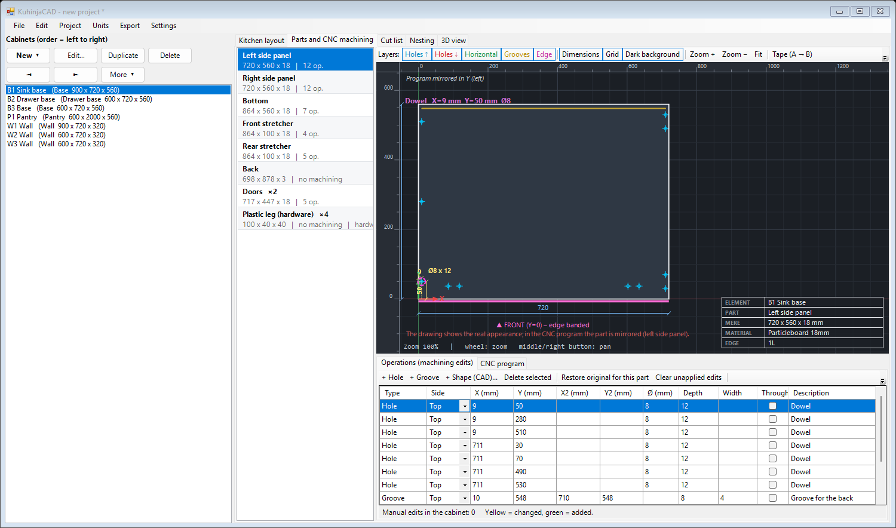

### Production: cut list, sheet optimization, labels
| Cut list | Nesting (sheet optimization) |
|---|---|
| 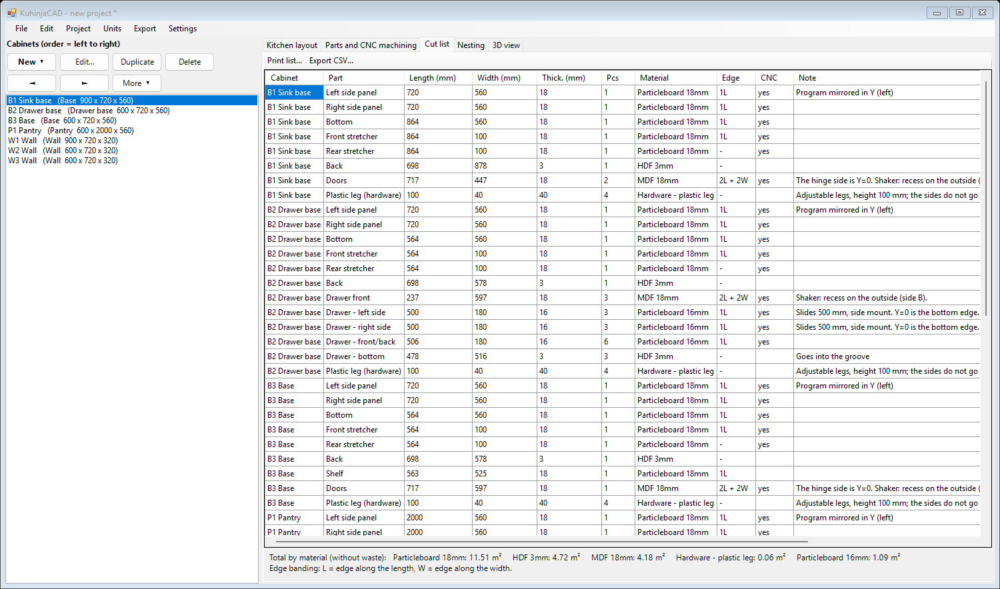 | 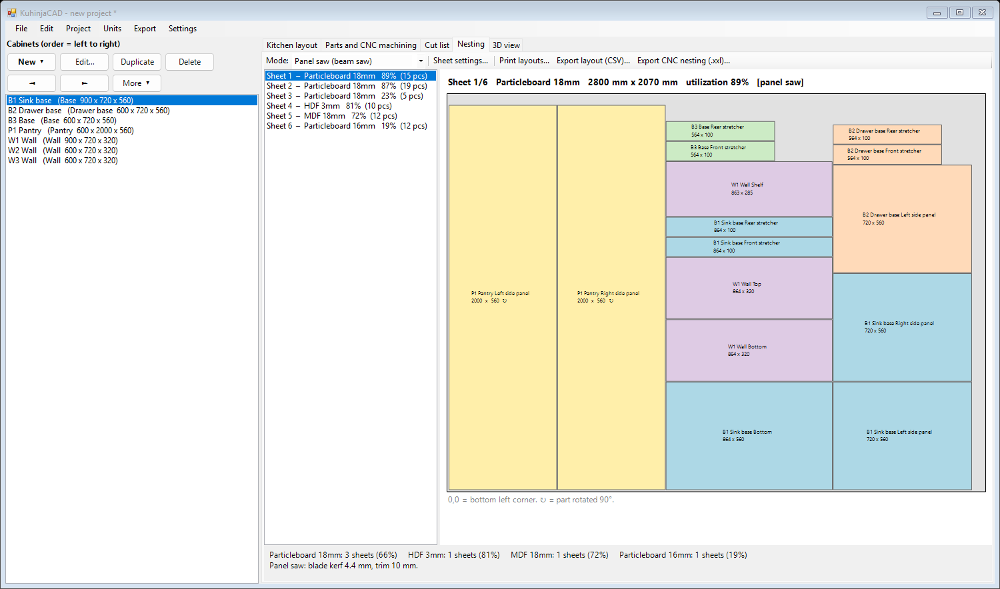 |

| Printed cut list | Part labels (50 × 30 mm) |
|---|---|
| 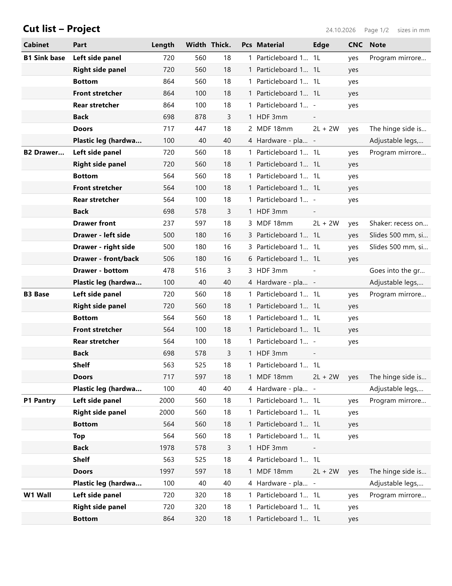 | 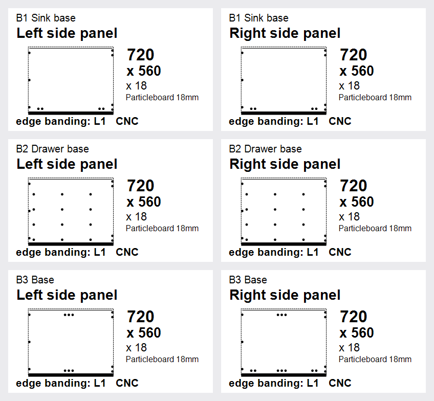 |

### Documents the program prints
| Assembly instructions | Shop drawing of a cabinet |
|---|---|
| 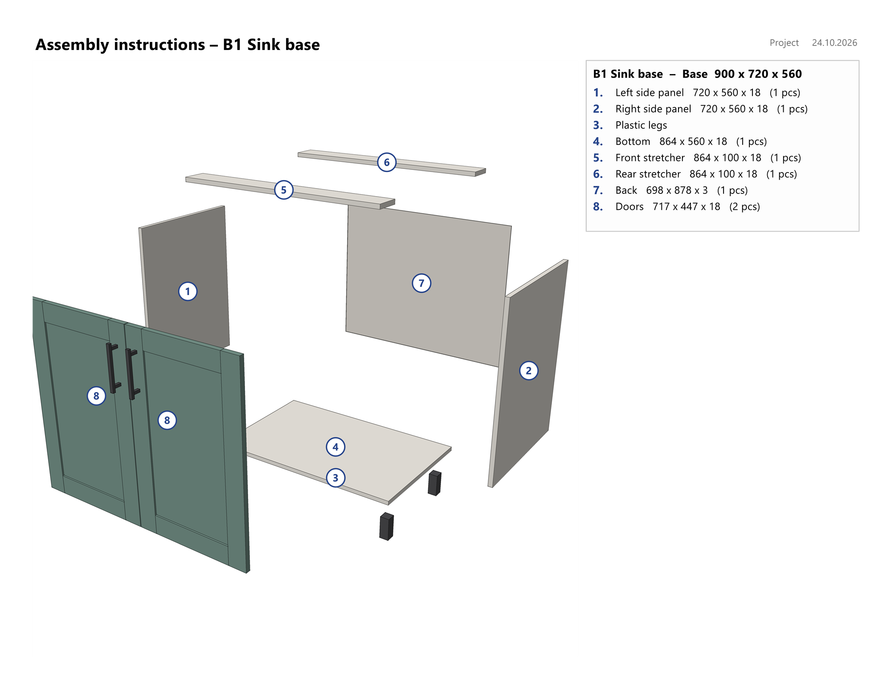 | 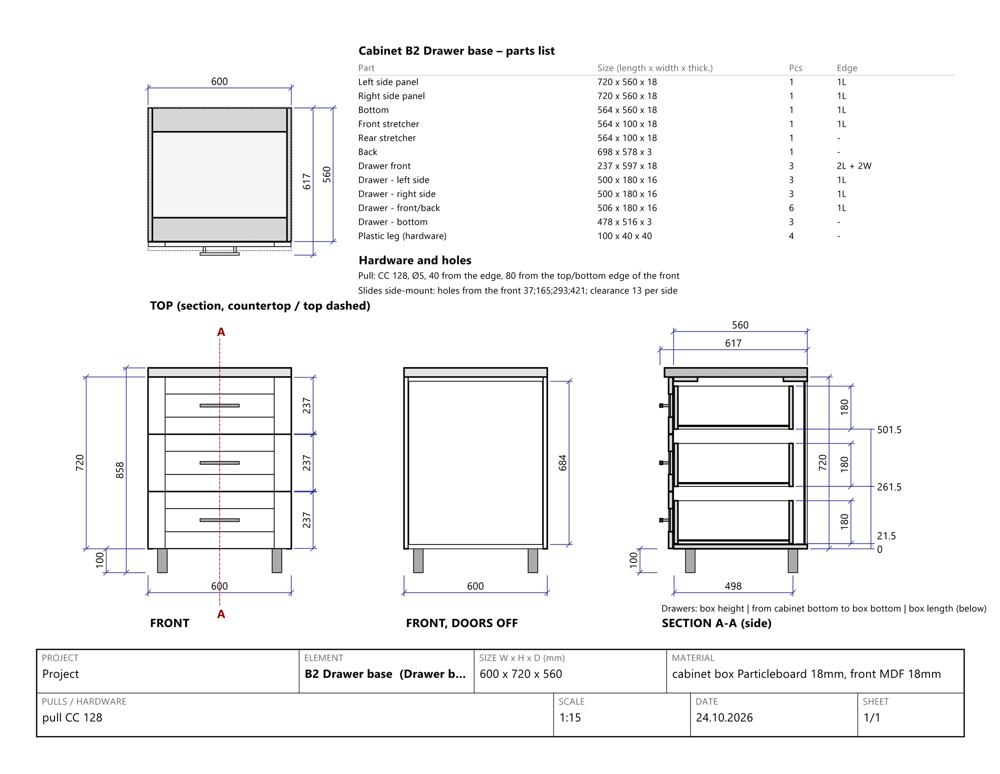 |

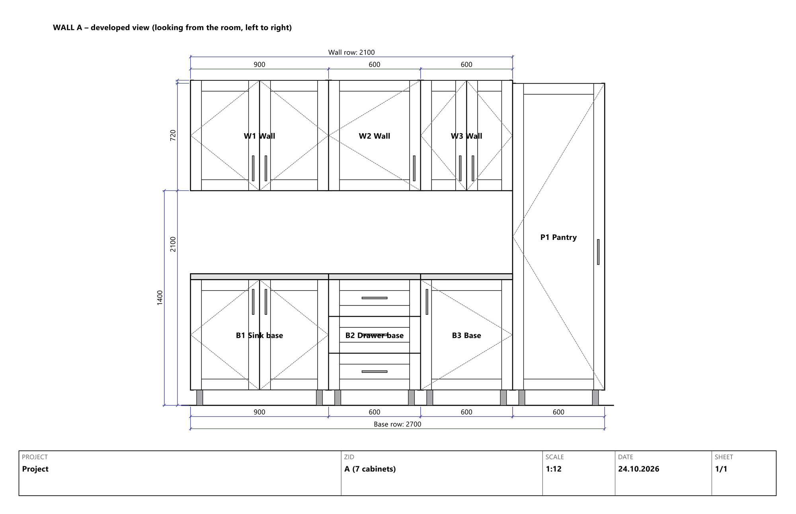

### Exploded cabinet with numbered parts
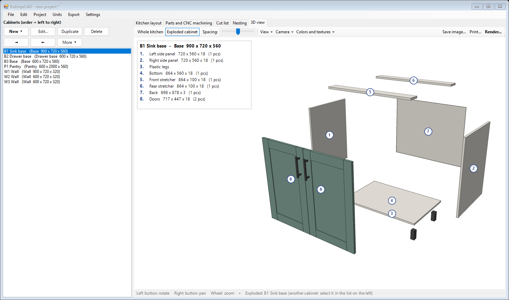

### Parametric options
| Cabinet properties | Project construction settings |
|---|---|
| 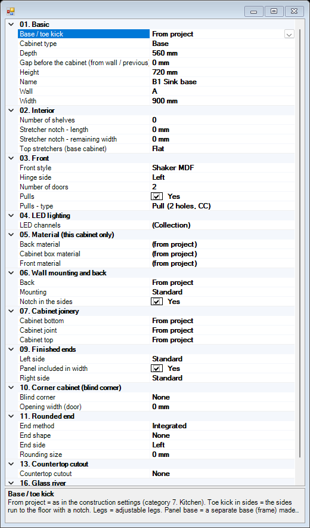 | 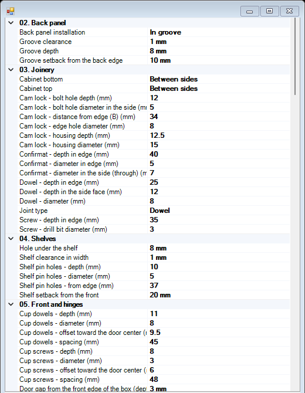 |

## Source code and live demo — on request

The source code is **private**. If you are considering me for a role and would like to see how the program works, I am happy to:

- give a **live demo** of the application,
- do a **code walkthrough** (screen share), or
- grant **temporary read-only access** to the private repository.

Please contact me through my GitHub profile or the contact details on my CV.

## Documentation

- [How it works](docs/HOW_IT_WORKS.md) — the idea, the data flow and notable techniques (no source code)
- [Tools used and what I learned](docs/TOOLS_AND_LEARNING.md) — editor, extensions, workflow and the role of AI assistance
- [Licenses and compliance](LICENSES_AND_COMPLIANCE.md) — ownership, tools' licenses, trademarks, what was deliberately left out

## Skills demonstrated

C# / .NET Framework · Windows Forms and GDI+ · software 3D rendering and Monte Carlo path tracing · computational geometry (polygon clipping and offsetting) · optimization (sheet nesting) · file-format writers (DXF, CNC text) · parametric modelling · localization · verification through built-in self-check modes · domain knowledge of cabinet making and CNC woodworking · responsible handling of licenses and third-party material.

## Status and limitations

- This is a learning / portfolio project, not a commercial product.
- Hardware dimensions (hinge cups, drawer slides, cam locks, rod supports) are sensible starting values and must be checked against manufacturer catalogues. Any generated CNC program must be simulated in the machine's own software before use.
- Tested through built-in self-check modes and screenshots rather than by a large group of users; some interactive details were checked by hand only.
- Windows only.

## License

© 2026 Ivana. All rights reserved. The documentation and screenshots in this repository may be viewed and shared with attribution, but not modified or used commercially. See [LICENSE](LICENSE).
